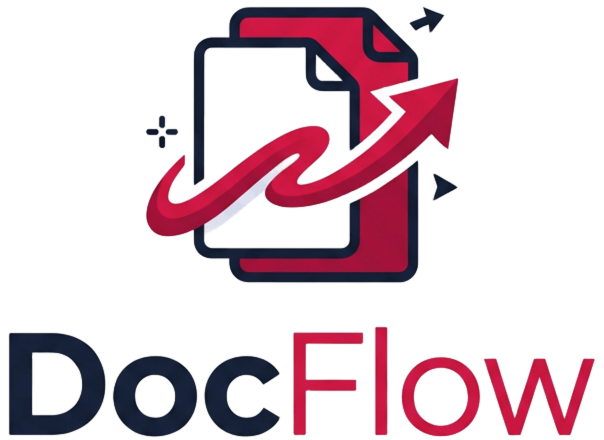

<div align="center">



# DocFlow — Universal Office to PDF Batch Converter

**High-fidelity, privacy-first, developer-grade document conversion platform for Microsoft Office to PDF.**

[](https://vercel.com)
[](https://render.com)
[](https://fastapi.tiangolo.com)
[](https://react.dev)
[](https://www.libreoffice.org)
[](LICENSE)

</div>

---

## 📌 Tentang DocFlow

**DocFlow** adalah aplikasi web modern yang dirancang untuk mengonversi berbagai dokumen Microsoft Office (Word, Excel, PowerPoint) ke format PDF secara presisi tanpa merusak tata letak (*layout fidelity*), font, margin, tabel, maupun gambar.

Dibangun dengan arsitektur **decoupled (terpisah)** antara frontend statis berkecepatan tinggi dan backend pemroses dokumen berbasis container Docker, DocFlow mampu memproses banyak file sekaligus (*batch processing*) serta mengunduh hasil konversi satuan atau dibundel dalam arsip `.ZIP`.

---

## ✨ Fitur Utama

- 📄 **Word to PDF**: Mengonversi `.docx`, `.doc`, `.rtf`, `.odt`, dan `.txt`.
- 📊 **Excel to PDF**: Mengonversi spreadsheet `.xlsx`, `.xls`, `.csv`, dan `.ods` dengan mempertahankan format sel dan tabel.
- 📽️ **PowerPoint to PDF**: Mengonversi slide presentasi `.pptx`, `.ppt`, dan `.odp` menjadi lembar PDF beresolusi tinggi.
- 📦 **Batch Multi-file Processing**: Upload banyak file sekaligus dari berbagai format Office dan unduh semua hasil dalam satu arsip `.ZIP`.
- 🛡️ **Zero Data Retention (Privasi Penuh)**: File yang diunggah dan dihasilkan langsung disimpan di ruang memori/temporer dan otomatis dihapus berkala (maksimal 30 menit masa simpan).
- ⚙️ **Dual-Engine Architecture**:
  - **Di Lingkungan Produksi (Render / Linux Docker)**: Berjalan di atas **LibreOffice Headless** dengan paket font TrueType lengkap (Liberation, DejaVu, FreeFont).
  - **Di Pengembangan Lokal (Windows)**: Otomatis mendeteksi dan memanfaatkan instalasi **Microsoft Office asli** (Word, Excel, PowerPoint via antarmuka COM) untuk konversi instan tanpa perlu install LibreOffice di komputer pengembang.
- 🎨 **Crafted UI / UX (Anti-AI-Slop)**:
  - Palet warna bersih bernuansa Netral/Zinc (`#FAFAFA` / `#09090B`).
  - Sistem pewarnaan dinamis kontekstual sesuai tab aktif (Merah untuk All Office, Biru untuk Word, Hijau untuk Excel, Oranye untuk PowerPoint).
  - Area Drag & Drop taktil responsif dengan filter format otomatis.
  - Carousel tab mulus tanpa scrollbar kaku di layar smartphone (*mobile-optimized*).
- ⚡ **Optimasi Free-Tier Khusus**:
  - **Font Cache Pre-warming**: Memindai dan mengompilasi cache font saat build image Docker (`fc-cache -fv`).
  - **Warm Profile Slot Pool**: Menghilangkan jeda boot 2–4 detik dengan mendaur ulang slot profil LibreOffice (`lo_slot_0`, `lo_slot_1`).
  - **Async Concurrency Limiter**: Konversi paralel hingga 2 file bersamaan (`asyncio.Semaphore(2)`) agar RAM 512 MB Render tetap stabil tanpa *Out of Memory*.
  - **Proactive Wake-up Ping**: Frontend otomatis mengirim sinyal `/api/ping` di latar belakang saat halaman dibuka untuk mempercepat proses *cold start* server gratis.
  - **Adaptive Timeout**: Batas waktu otomatis menyesuaikan ukuran file (hingga 300 detik untuk dokumen di atas 15 MB).

---

## 🏗️ Arsitektur Sistem

```text
[ Browser / Client ] (React + Vite di Vercel CDN)
         │
         │  1. Silent /api/ping (Pre-warm backend on page visit)
         │  2. Multipart/form-data upload (Batch Office files)
         ▼
[ FastAPI Backend ] (Python 3.11 di Render Container)
         │
         ├── Concurrency Limiter (asyncio.Semaphore(2))
         ├── ThreadPoolExecutor (Non-blocking Event Loop)
         ▼
[ Conversion Engine ]
   ├── Production (Linux Docker): LibreOffice Headless + Warm Profile Pool
   └── Local Dev (Windows): Microsoft Office Native COM Automation
         │
         ▼
[ Ephemeral Storage & Packager ]
   ├── Converted PDF(s)
   ├── ZIP Archive Bundler (/api/download-zip)
   └── Auto-Cleaner Background Task (Purge files > 30 minutes)
```

---

## 📁 Struktur Direktori

```text
converter/
├── client/                     # Frontend Application (Deploy ke Vercel)
│   ├── public/                 # Favicon, Logo Emblem, Logo Full
│   ├── src/
│   │   ├── components/
│   │   │   ├── BatchActionBar.tsx  # Floating bottom action bar & ZIP downloader
│   │   │   ├── Dropzone.tsx        # Dynamic themed Drag-and-drop zone
│   │   │   ├── FileCard.tsx        # File queue item with format badges & status
│   │   │   ├── Header.tsx          # Minimalist header with DocFlow brand logo
│   │   │   ├── ToolTabs.tsx        # Contextual tool switcher tabs
│   │   │   └── TrustBadges.tsx     # Feature & privacy highlights
│   │   ├── config.ts           # API Base URL resolver
│   │   ├── types.ts            # TypeScript interfaces
│   │   ├── App.tsx             # Main layout, batch state, & proactive ping
│   │   └── main.tsx            # Entry point
│   ├── package.json
│   ├── tailwind.config.js
│   └── vite.config.ts          # Reverse proxy setup for local development
│
├── server/                     # Backend Application (Deploy ke Render)
│   ├── app/
│   │   ├── api/
│   │   │   ├── convert.py      # /api/convert/batch, /single, /download, /ping
│   │   ├── services/
│   │   │   ├── converter.py    # LibreOffice pool & Windows Office fallback
│   │   │   └── cleaner.py      # Retention cleaner scheduler
│   │   ├── config.py           # CORS & environmental settings
│   │   └── main.py             # FastAPI bootstrap
│   ├── Dockerfile              # Container spec for server subfolder
│   └── requirements.txt        # Python dependencies
│
├── Dockerfile                  # Root Dockerfile untuk auto-build di Render
├── .dockerignore
├── .gitignore
└── README.md
```

---

## 💻 Panduan Menjalankan di Lokal (Development)

### Prasyarat
- **Node.js** (v18 ke atas) & **npm**
- **Python** (v3.10 ke atas)
- *Opsional untuk Windows*: Microsoft Office (Word, Excel, PowerPoint) atau LibreOffice terpasang.

### 1. Menjalankan Backend (FastAPI)
Buka terminal pertama:
```powershell
cd server

# Buat dan aktifkan virtual environment (Windows PowerShell)
python -m venv venv
.\venv\Scripts\Activate.ps1

# Install dependensi
pip install -r requirements.txt

# Jalankan server
uvicorn app.main:app --reload --port 8000
```
- Endpoint Dokumentasi API Interaktif (Swagger UI): `http://localhost:8000/docs`
- Status Cek Engine: `http://localhost:8000/api/status`

### 2. Menjalankan Frontend (React + Vite)
Buka terminal kedua:
```powershell
cd client

# Install dependensi
npm install

# Jalankan server Vite
npm run dev
```
Buka browser di: `http://localhost:5173`

> **Catatan Dev Lokal**: `vite.config.ts` sudah dikonfigurasikan dengan *reverse proxy* internal. Semua panggilan ke `/api` dari port `5173` otomatis diteruskan ke backend port `8000` tanpa kendala CORS maupun perbedaan alamat IPv4/IPv6.

---

## 🚀 Panduan Deployment ke Cloud

DocFlow didesain agar dapat di-deploy secara **100% gratis** menggunakan kombinasi **Render** (Backend Docker) dan **Vercel** (Frontend CDN).

### Tahap 1: Push Repository ke GitHub
Pastikan seluruh kode telah di-commit ke branch `main` di akun GitHub Anda:
```bash
git add .
git commit -m "feat: release DocFlow converter"
git push origin main
```

---

### Tahap 2: Deploy Backend ke Render (Gratis)
1. Masuk ke [dashboard.render.com](https://dashboard.render.com).
2. Klik **New +** $\rightarrow$ pilih **Web Service**.
3. Hubungkan repository GitHub Anda.
4. Isi konfigurasi layanan:
   - **Name**: `docflow-backend` (atau nama lain)
   - **Region**: Pilih yang terdekat (contoh: `Singapore`)
   - **Root Directory**: *Biarkan kosong* (Render otomatis membaca `Dockerfile` di root)
   - **Environment / Runtime**: **Docker**
   - **Instance Type**: **Free**
5. Pada tab **Environment Variables**, tambahkan:
   - `ALLOWED_ORIGINS`: `*`
   - `FILE_RETENTION_MINUTES`: `30`
   - `MAX_FILE_SIZE_MB`: `50`
6. Klik **Create Web Service**.
7. Tunggu proses build Docker selesai hingga status berubah menjadi **Live**. Salin URL layanan Anda (contoh: `https://docflow-backend.onrender.com`).

---

### Tahap 3: Deploy Frontend ke Vercel
1. Masuk ke [vercel.com](https://vercel.com).
2. Klik **Add New...** $\rightarrow$ **Project**, lalu klik **Import** pada repository GitHub Anda.
3. Pada halaman konfigurasi:
   - **Framework Preset**: `Vite`
   - **Root Directory**: Klik **Edit** dan pilih folder **`client`** *(Wajib)*
4. Pada bagian **Environment Variables**:
   - **Key**: `VITE_API_URL`
   - **Value**: Masukkan URL Render Anda dari Tahap 2 (contoh: `https://docflow-backend.onrender.com` *tanpa garis miring di akhir*)
5. Klik **Deploy**. Web Anda akan langsung aktif dengan domain Vercel (contoh: `https://docflow-converter.vercel.app`).

---

### 💡 Tips: Menjaga Backend Render Aktif 24/7 (Anti-Sleep)
Secara bawaan, server gratis Render akan masuk ke mode *sleep* setelah 15 menit tanpa aktivitas. Untuk mencegah *cold start* 30–50 detik bagi pengguna pertama:
1. Buka layanan cron gratis seperti [cron-job.org](https://cron-job.org) atau [uptimerobot.com](https://uptimerobot.com).
2. Buat jadwal ping HTTP GET baru ke alamat:
   ```text
   https://URL-RENDER-ANDA.onrender.com/api/ping
   ```
3. Atur frekuensi eksekusi setiap **10 menit sekali**.
4. Server Render Anda akan terjaga aktif sepanjang waktu tanpa biaya tambahan!

---

## 🛠️ API Reference

| Method | Endpoint | Deskripsi |
| :--- | :--- | :--- |
| `GET` | `/health` | Healthcheck dasar untuk load balancer / hosting |
| `GET` | `/api/ping` | Endpoint ringan untuk keep-alive cron & wake-up |
| `GET` | `/api/status` | Informasi status engine konversi & format yang didukung |
| `POST` | `/api/convert/single` | Mengonversi 1 file Office dan langsung streaming file PDF |
| `POST` | `/api/convert/batch` | Mengonversi multi-file Office paralel dan menghasilkan daftar URL unduh |
| `GET` | `/api/download/{job_id}/{filename}` | Mengunduh file PDF hasil konversi perorangan |
| `GET` | `/api/download-zip/{job_id}` | Mengunduh seluruh PDF dalam satu batch job sebagai arsip `.ZIP` |

---

## 📜 Lisensi

Didistribusikan di bawah lisensi MIT. Silakan gunakan, modifikasi, dan kembangkan untuk kebutuhan pribadi maupun komersial.
